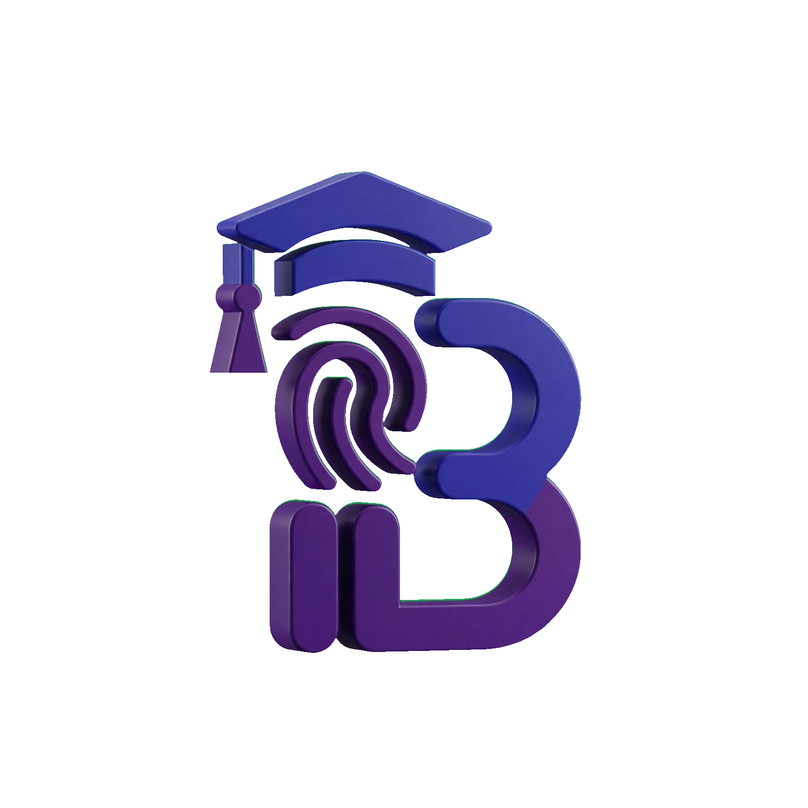
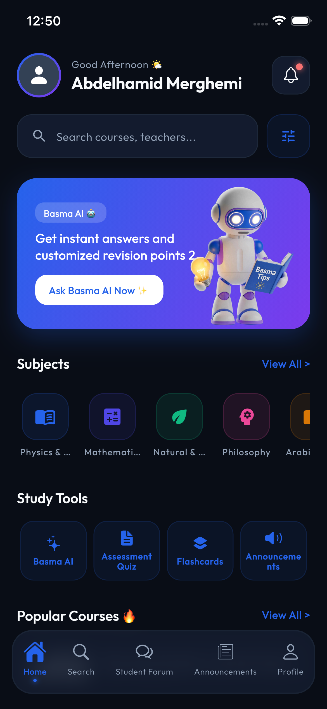
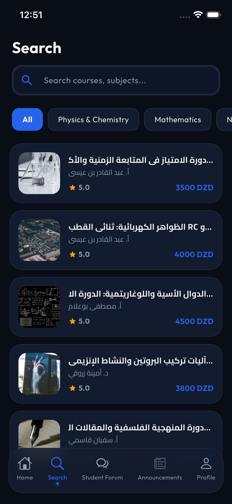
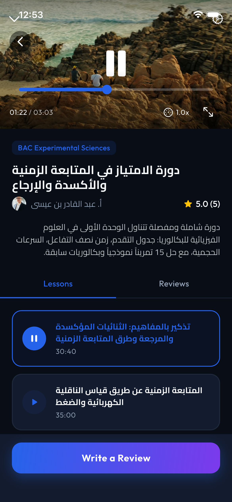
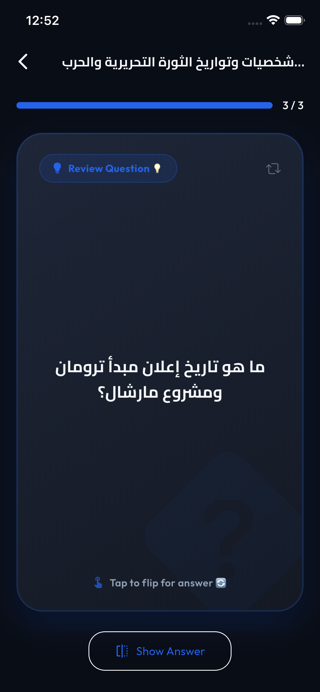
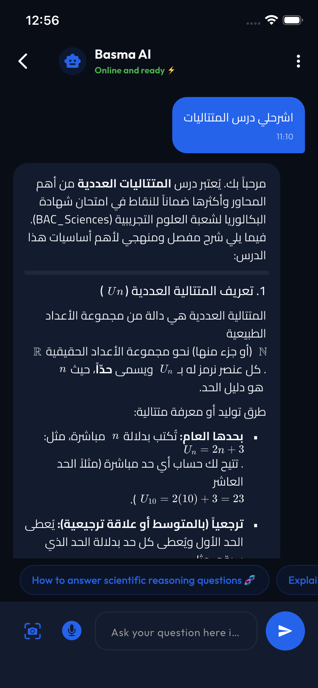
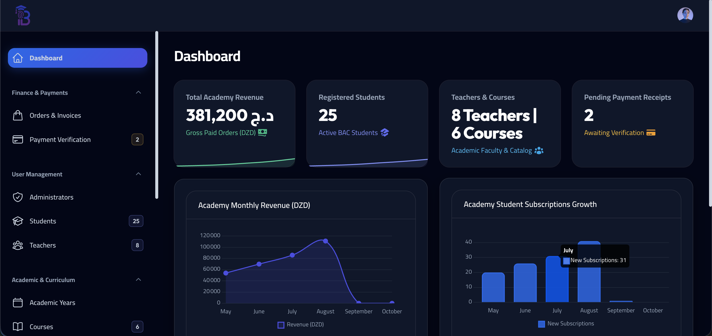
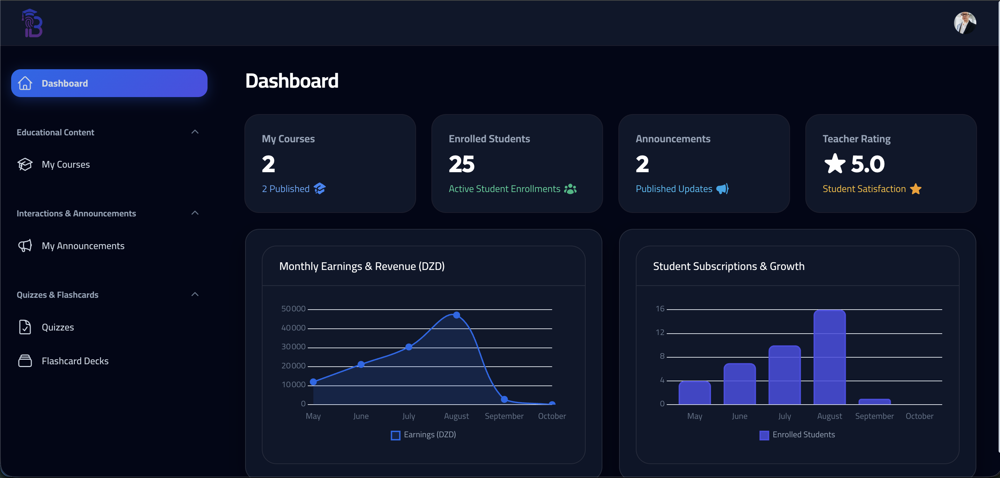
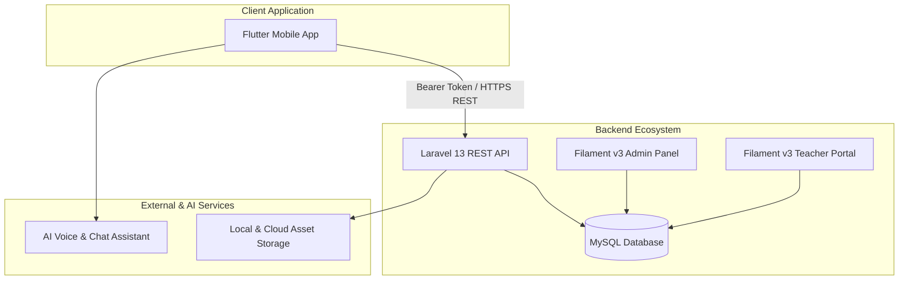

<p align="center">
  
</p>

<h1 align="center">Basma Academy — Full-Stack EdTech Platform</h1>

<p align="center">
  <strong>An educational platform designed for high school and Algerian Baccalaureate students, combining a cross-platform Flutter mobile app, a Laravel REST API, and dual Filament v3 web management portals.</strong>
</p>

<p align="center">
  <a href="https://flutter.dev"></a>
  <a href="https://dart.dev"></a>
  <a href="https://laravel.com"></a>
  <a href="https://filamentphp.com"></a>
  <a href="https://mysql.com"></a>
</p>

---

## Product Showcase

### 1. Mobile Experience (Flutter)
The student mobile application provides structured exam preparation aligned with Algerian national academic streams (*Experimental Sciences, Mathematics, Technical Math, Literature & Philosophy, Management & Economics*).

| 1. Home Dashboard | 2. Course Catalog | 3. Video Player |
| :---: | :---: | :---: |
|  |  |  |
| **Baccalaureate Countdown & Enrolled Courses** | **Subject & Stream Filtering** | **Chaptered Lessons & Real-Time Progress** |

| 4. Spaced-Repetition Flashcards | 5. AI Voice & Chat Tutor |
| :---: | :---: |
|  |  |
| **Active-Recall Exam Revision Decks** | **Voice Wave UI & Interactive Revision Assistant** |

---

### 2. Web Management Portals (Laravel & Filament)
Two dedicated web administration panels provide backoffice control for academy administrators and instructors.

| Platform Admin Dashboard (`/admin`) |
| :---: |
|  |
| *Platform revenue analytics, monthly enrollment metrics, user management, and manual payment verification (BaridiMob / CCP receipts).* |

| Instructor Studio (`/teacher`) |
| :---: |
|  |
| *Course curriculum builder, chapter and video management, quiz creator, student enrollment counts, and revenue tracking.* |

---

## System Architecture

Basma Academy contains both the Flutter mobile client and the Laravel backend in this repository:

```text
basma-academy/
├── mobile/     # Flutter mobile application (iOS & Android)
│   ├── lib/
│   │   ├── core/         # Network client, theme, localizations, base widgets
│   │   └── features/     # Auth, Catalog, Course, Flashcards, AI Tutor, Forum
│   └── assets/           # Fonts, 3D brand assets, SVG icons, animations
│
├── backend/    # Laravel 13 REST API & Dual Filament v3 Panels
│   ├── app/
│   │   ├── Filament/     # /admin and /teacher resource panels
│   │   ├── Http/         # API controllers, middleware, request validation
│   │   └── Models/       # Courses, Users, Payments, Quizzes, Flashcards
│   ├── database/         # Migrations, seeders, and factory schemas
│   └── routes/           # api.php, web.php, channels.php
│
└── docs/       # Architecture documents, diagrams, and UI screenshots
```



---

## Core Feature Matrix

### Student Mobile Application
- **Baccalaureate Exam Countdown**: Circular progress gauge counting down to official national exam dates.
- **AI Voice & Chat Tutor**: Speech recognition (STT) and conversational assistant for revision support.
- **Chaptered Video Lessons**: Custom video streaming player with timestamped notes, downloadable materials, and lesson completion markers.
- **Active-Recall Flashcards**: Spaced-repetition revision cards organized by subject and exam difficulty.
- **Offline Caching**: Cached study materials allowing students to review content with low connectivity.
- **CCP / BaridiMob Payment Upload**: Direct receipt slip upload for manual transaction validation by platform operators.

### Teacher Studio (`/teacher`)
- **Self-Service Course Builder**: Draft and publish structured courses with organized modules and lessons.
- **Integrated Quiz Creator**: Create interactive multiple-choice quizzes attached to specific video lessons.
- **Flashcard Deck Authoring**: Create spaced-repetition card decks for enrolled students.
- **Revenue & Enrollment Analytics**: Visual charts showing enrollments and commission earnings.

### Academy Control Center (`/admin`)
- **Payment Verification**: Review and approve manual bank receipts (BaridiMob/CCP) with automated enrollment activation upon approval.
- **Instructor Management**: Screen, approve, or manage teacher accounts across academic streams.
- **Platform Telemetry**: Monitor daily active users, subscription retention, and revenue volume over time.
- **Catalog Moderation**: Manage course visibility, announcements, and content standards across academic streams.

---

## Getting Started

### Prerequisites
- **Flutter SDK**: `3.24.0+`
- **PHP**: `8.3+` (Tested on PHP 8.5)
- **Composer**: `2.7+`
- **Node.js**: `18.0+`
- **MySQL**: `8.0+`

---

### 1. Backend Setup (Laravel 13)

```bash
cd backend

# Install PHP and Node dependencies
composer install
npm install

# Setup environment configuration
cp .env.example .env
php artisan key:generate

# Run migrations and seed sample demo data
php artisan migrate --seed

# Link public storage for uploads
php artisan storage:link

# Start the development server
php artisan serve --host=0.0.0.0 --port=8000
```

> **Default Demo Portals:**
> - **Admin Control Panel**: `http://localhost:8000/admin` (Email: `admin@basma.academy` / Password: `password`)
> - **Teacher Studio**: `http://localhost:8000/teacher` (Email: `teacher@basma.academy` / Password: `password`)

---

### 2. Mobile Setup (Flutter)

```bash
cd mobile

# Install Flutter dependencies
flutter pub get

# Run on an emulator, simulator, or connected device
flutter run --dart-define=API_BASE_URL=http://<YOUR_LOCAL_IP>:8000/api
```

> *Tip: For local testing, Android emulators connect to the host machine via `http://10.0.2.2:8000/api`, while iOS simulators can connect via `http://127.0.0.1:8000/api`.*

---

## Author & Engineering Credits

Built by **Abdelhamid Merghemi**  
- **GitHub**: [@abdelhamidmerghemi](https://github.com/abdelhamidmerghemi)  
- **Role**: Full-Stack & Mobile Software Engineer  
- **Focus**: Flutter, Dart, Laravel Ecosystem, Distributed Backends & Modern UI/UX

---

## License
This project is proprietary and developed for portfolio showcase and commercial licensing. All rights reserved.
